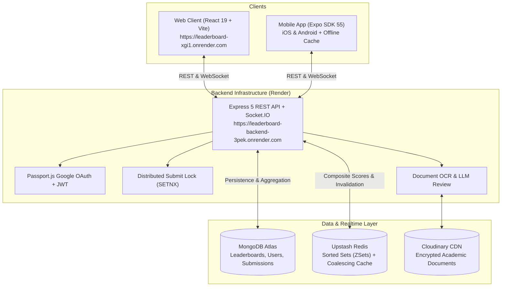

# EliteBoards 🏆

[](https://github.com/PARASMANI-KHUNTE/Leaderboard/actions/workflows/ci.yml)
[](https://github.com/PARASMANI-KHUNTE/Leaderboard/actions/workflows/cd.yml)
[](https://github.com/PARASMANI-KHUNTE/Leaderboard/actions/workflows/security.yml)
[](https://leaderboard-xgi1.onrender.com)
[](https://leaderboard-backend-3pek.onrender.com/health)

EliteBoards is an enterprise-grade, real-time academic and competitive leaderboard ecosystem. Engineered to eliminate manual spreadsheets, outdated PDFs, and fraudulent score claims, it powers universities, student batches, and hackathons with sub-10ms rankings and automated document verification.

---

## 🌐 Live Deployments

| Component | Status | Production URL |
| :--- | :--- | :--- |
| **Web Portal** | 🟢 Live | [https://leaderboard-xgi1.onrender.com](https://leaderboard-xgi1.onrender.com) |
| **Backend API** | 🟢 Live | [https://leaderboard-backend-3pek.onrender.com](https://leaderboard-backend-3pek.onrender.com) |
| **API Health Check** | 🟢 Live | [https://leaderboard-backend-3pek.onrender.com/health](https://leaderboard-backend-3pek.onrender.com/health) |
| **Mobile App (OTA)**| 🟢 Live | Published on Expo EAS (`production` channel) |

---

## 📖 About EliteBoards

EliteBoards was designed from the ground up to solve two foundational problems in academic and competitive ranking: **real-time synchronization under high concurrency** and **tamper-proof authenticity**.

### Core Architecture Pillars
1. **⚡ Sub-10ms Redis Sorted Sets Engine**: Ranks are computed on $O(\log N)$ Redis ZSets using a composite score function ($\text{CGPA} \times 10^6 + \text{Marks}$). Ties are broken deterministically by submission timestamp.
2. **🛡️ Autonomous Document Verification**: Prevents fraudulent scores via a multi-stage verification pipeline: image optimization (Sharp), optical character recognition (Tesseract OCR), and LLM-assisted verification (OpenRouter) comparing university ID cards with academic grade cards.
3. **📱 Cross-Platform Parity**: A responsive React 19 web portal combined with a native Expo SDK 55 mobile app for iOS and Android, backed by TanStack Query and offline-first JSON disk caching.
4. **🔒 Concurrency & Anti-Tamper Security**: Distributed Redis `SETNX` idempotency mutex prevents double submissions, while atomic MongoDB array operators (`$addToSet`, `$pull`) prevent reaction counter race conditions.
5. **🛡️ Fail-Fast Resilience**: Automatic active circuit breaker drops unreachable Redis connections in < 1000ms, seamlessly falling back to MongoDB aggregation pipelines with zero downtime.

---

## 📐 System Architecture



---

## 📁 Workspace Structure

```
├── .github/workflows/          # CI/CD Workflows
│   ├── ci.yml                  # Linting, unit tests, concurrency tests, mobile Hermes export
│   ├── cd.yml                  # Render deployment trigger, health polling, Expo EAS OTA updates
│   └── security.yml            # GitHub CodeQL Advanced Security scanning
├── client/Leaderboard/         # Web Application (React 19, Vite, Tailwind CSS, Lucide)
├── server/                     # Backend API (Express 5, MongoDB, Redis, Socket.IO)
│   ├── config/                 # Database & fail-fast Redis configuration with circuit breaker
│   ├── models/                 # Mongoose schemas with compound uniqueness & indexes
│   ├── routes/                 # REST endpoints with distributed mutex & coalescing cache
│   ├── scripts/                # Database seeding tool (npm run seed)
│   ├── services/               # OCR & OpenRouter LLM document verification pipeline
│   ├── test/                   # Automated unit, validation, and high-concurrency stress tests
│   └── utils/                  # Redis composite score ranking engine & push notifications
├── mobile/eliteboards-mobile/  # Mobile Application (Expo SDK 55, Expo Router, TanStack Query)
└── docs/                       # Engineering Documentation & Architecture Guides
```

---

## 🚀 Quick Start (Root Workspace Commands)

You can manage, develop, test, and build the entire workspace directly from the repository root:

### 1. Install All Dependencies

```bash
npm install
```

### 2. Start Development Servers

```bash
# Start Backend API (http://localhost:5000)
npm run dev:server

# Start Web Client (http://localhost:5173)
npm run dev:web

# Start Mobile App (Expo Metro bundler on port 8081)
npm run dev:mobile
```

### 3. Seed Realistic Database Test Data

To seed administrator accounts, 12 realistic student profiles, 4 leaderboards, 23 entries with reactions, and verification submissions:

```bash
npm run seed --prefix server
```

### 4. Verification & Testing

```bash
# Run all automated test suites across Server, Web, and Mobile
npm test

# Run code syntax & linting checks
npm run lint

# Run TypeScript typechecks
npm run typecheck

# Build web distribution and verify mobile Hermes bundles
npm run build

# Clean temporary build artifacts
npm run clean
```

---

## ⚙️ Environment Configuration

Copy the example environment files in each application directory:

```bash
# Server configuration
cp server/.env.example server/.env

# Web client configuration
cp client/Leaderboard/.env.example client/Leaderboard/.env

# Mobile configuration
cp mobile/eliteboards-mobile/.env.example mobile/eliteboards-mobile/.env
```

### Backend (`server/.env`):
```env
PORT=5000
MONGODB_URI=mongodb://localhost:27017/MCAleaderBoard
JWT_SECRET=your_jwt_secret
CLIENT_URL=http://localhost:5173
CLIENT_URLS=http://localhost:5173,http://127.0.2.1:5173,https://leaderboard-xgi1.onrender.com
ADMIN_EMAIL=parasmanikhunte@gmail.com
# Optional: Upstash Redis connection
UPSTASH_REDIS_REST_URL=https://...
UPSTASH_REDIS_REST_TOKEN=...
```

### Web Client (`client/Leaderboard/.env`):
```env
VITE_API_URL=http://localhost:5000
```

### Mobile App (`mobile/eliteboards-mobile/.env`):
```env
# For local Android emulator: http://10.0.2.2:5000
# For physical device / LAN: http://<HOST_IP>:5000
# For production backend: https://leaderboard-backend-3pek.onrender.com
EXPO_PUBLIC_API_URL=http://10.0.2.2:5000
```

---

## 🔄 Standardized 9-Step GitHub Workflow

Every contribution, bug fix, and feature addition strictly adheres to our production workflow:

1. **Issue Creation**: File an issue detailing requirements (`gh issue create`).
2. **Branch Isolation**: Branch off `main` (`git checkout -b fix/<name>` or `feat/<name>`).
3. **Local Verification**: Run all unit tests, web build, and mobile typecheck.
4. **Referenced Commit**: Commit using conventional commits (`git commit -m "... (fixes #<id>)"`).
5. **Open Pull Request**: Create PR referencing the issue (`gh pr create --base main`).
6. **CI & Security Gates**: GitHub Actions automatically runs the Node 20/22 test matrix, Vite build, Expo Doctor, and CodeQL security scan.
7. **Merge PR**: Merge into `main` (`gh pr merge --merge`), auto-closing the issue and advancing GitHub profile achievements.
8. **Branch Cleanup**: Fast-forward local `main` and delete feature branches locally and remotely.
9. **Continuous Deployment**: Automated CD workflow immediately redeploys the backend to Render, packages production web bundles, and pushes Expo EAS OTA updates.

---

## 📚 Documentation Index

- [Architecture Overview](docs/architecture.md)
- [CI/CD Pipeline & Deployment Guide](docs/ci-cd.md)
- [Testing & Verification Guide](docs/testing-and-ci.md)
- [Production Readiness Checklist](docs/production-readiness.md)
- [Mobile OTA Updates Guide](docs/mobile-ota.md)
- [Mobile Release Checklist](docs/mobile-release-checklist.md)
- [Feature Report](docs/feature-report.md)

---

## 👨‍💻 Author

**Parasmani Khunte**
- GitHub: [@PARASMANI-KHUNTE](https://github.com/PARASMANI-KHUNTE)
- LinkedIn: [Parasmani Khunte](https://www.linkedin.com/in/parasmani-khunte-330488228/)
- Portfolio: [https://parasmanikhunte.onrender.com/](https://parasmanikhunte.onrender.com/)
- Email: [parasmanikhunte@gmail.com](mailto:parasmanikhunte@gmail.com)
