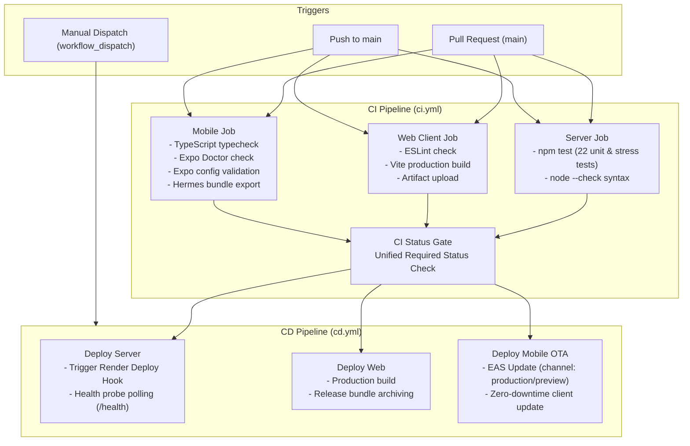

# CI/CD Pipeline & Deployment Guide

This document details the Continuous Integration (CI) and Continuous Deployment (CD) architecture for EliteBoards across the Server, Web, and Mobile codebases.

---

## 1. Pipeline Architecture



---

## 2. CI Workflows (`.github/workflows/ci.yml`)

Runs automatically on every Pull Request and Push targeting `main` or `master`.
Includes `concurrency: cancel-in-progress` to prevent wasted runner minutes on outdated commits.

| Job | Working Directory | Primary Tasks | Artifacts |
| :--- | :--- | :--- | :--- |
| **Server Tests & Lint** | `server/` | `npm run check`, `npm test` (unit, validation, Redis ranking & concurrency tests) | N/A |
| **Web Client Lint & Build** | `client/Leaderboard/` | `npm run lint` (ESLint), `npm run build` (Vite) | `web-dist` (7 days retention) |
| **Mobile Verification & Export** | `mobile/eliteboards-mobile/` | `tsc --noEmit`, `expo config`, `expo-doctor`, `expo export` | Verified Hermes bundles |
| **CI Status Gate** | Root | Evaluates all 3 jobs as a single branch-protection gate | Pipeline Pass/Fail |

---

## 3. CD Workflows (`.github/workflows/cd.yml`)

Triggered automatically on `push: [main]` and manually via GitHub Actions UI (`workflow_dispatch`).

### A. Backend API Deployment
- **Method**: Render Webhook Deploy Hook.
- **Verification**: Polls `${BACKEND_URL}/health` every 10 seconds (up to 12 attempts) until status reports `UP`.

### B. Web Application Packaging
- Compiles the web application against the production API URL.
- Packages and stores the production distribution artifact (`production-web-bundle`) for 30 days.

### C. Mobile Over-The-Air (OTA) Updates
- Uses Expo Application Services (EAS) CLI.
- Automatically publishes JavaScript and asset updates to installed applications using runtime version matching:
  ```bash
  npx eas-cli update --auto --channel production --non-interactive
  ```
- **Zero App Store review delay**: Updates are received instantly when users launch the app.

---

## 4. Required GitHub Secrets

To enable automated CD deployments, configure these repository secrets under **Settings > Secrets and variables > Actions**:

| Secret Name | Description | Required For |
| :--- | :--- | :--- |
| `RENDER_DEPLOY_HOOK_URL` | Webhook URL from Render service settings to trigger builds | Automated Server Deployment |
| `PRODUCTION_API_URL` | Production API domain (e.g., `https://leaderboard-backend-3pek.onrender.com`) | Health Checks & Client Builds |
| `EXPO_TOKEN` | Expo Personal Access Token (from `expo.dev/settings/access-tokens`) | Automated Mobile OTA Updates |

---

## 5. Security & Static Analysis (`.github/workflows/security.yml`)

- Automatically runs GitHub **CodeQL Advanced Security Analysis** across all JavaScript and TypeScript files.
- Analyzes routes, authentication middlewares, and query constructions for vulnerabilities on pull requests and on a weekly schedule.
